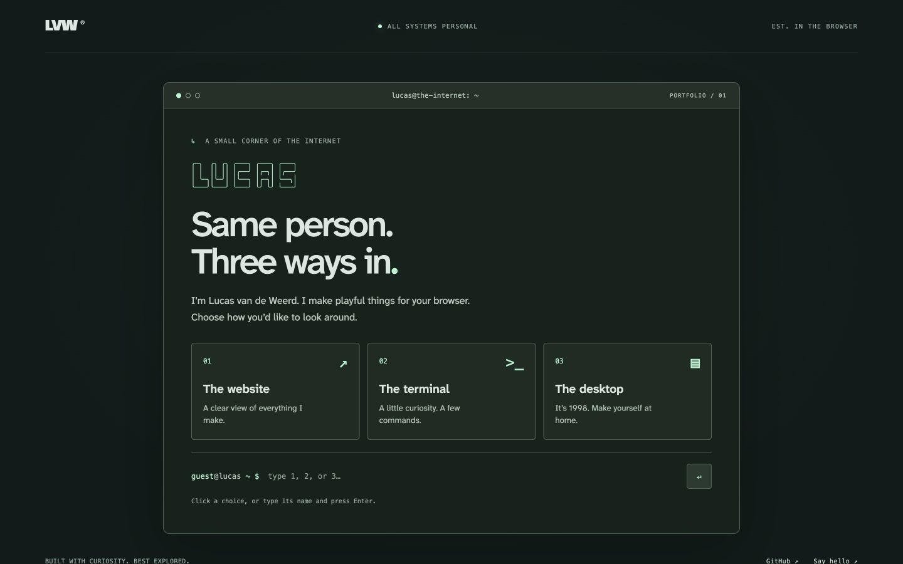
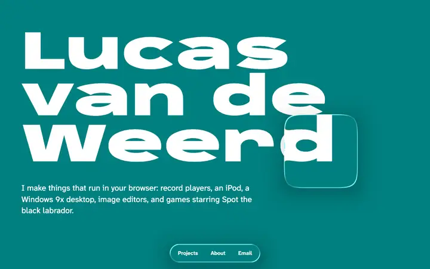

<div align="center">

# gitguy268.github.io

**One portfolio, three ways to explore: a website, a terminal, and a Windows 98 desktop.**

[Open the page](https://gitguy268.github.io/) · [Docs](#docs) · [Cursors](#cursors) · [The glass](#the-glass) · [Run it](#run-it) · [Edit it](#edit-it) · [Credits](#credits)




</div>

Plain HTML, CSS, and JavaScript, with locally hosted fonts and screenshots. Nothing to install and no build step.

<!-- run-steps:start -->
## Run it locally, step by step

1. **Get the code:**

   ```sh
   git clone https://github.com/Gitguy268/Gitguy268.github.io.git
   cd Gitguy268.github.io
   ```

2. **Start a local web server** (Python 3 comes with macOS and most Linux systems):

   ```sh
   python3 -m http.server 8000
   ```

3. **Open <http://localhost:8000/>** in your browser. Press `Ctrl+C` in the terminal to stop.

<!-- run-steps:end -->

## Three ways in

The root page is a terminal-style chooser. Click a choice or type `1`, `2`, `3`, `website`, `terminal`, or `desktop`. It always appears on a new root visit; it does not store a preferred mode.

- `/?view=website`: the teal glass introduction, three featured public projects, searchable category filters, all 48 projects in seven categories, each with a link to its docs page, About, and contact. Press `/` or Ctrl+K (⌘K on a Mac) to jump to a project by name.
- `/?view=terminal`: commands, history with Up/Down, Tab completion, clickable suggestions, and four themes.
- `/?view=desktop`: a Windows 98-inspired desktop with project folders, About, Contact, Terminal, Notepad, Minesweeper, and Mouse settings.

Every experience has a Switch experience control. Direct links, refresh, browser Back/Forward, and the existing `#projects`, `#about`, and category anchors work. Without JavaScript, the complete normal website remains readable.

### Terminal commands

`help`, `about`, `projects`, `projects <category>`, `open <project-id>`, `contact`, `github`, `clear`, `history`, `theme mint|amber|hyper|crt`, `cursor system|vinyl|glass|spot`, `neofetch`, `website`, `desktop`, and `exit`.

The categories also work as folders: `ls`, `cd players`, `cd terminal-ai`, `cat ipod`, `pwd`, and `cd ..`.

The terminal only interprets this portfolio's commands. It does not execute shell commands or fetch repositories at runtime.

### Desktop controls

Open an icon or use Start. Drag a title bar to move a window, drag its lower-right handle to resize, or use the minimize/maximize/close controls. Taskbar buttons restore windows. Focus a title bar and use arrow keys to move it, Shift+arrows to resize, or Ctrl for one-pixel steps. On phones, windows fill the workspace.

Notepad autosaves locally and can download a `.txt` file. If storage is blocked, it still works for the session and export remains available. Notes are never uploaded.

Minesweeper has a 9×9 board, ten mines, and a safe first move. Right-click, press F on a focused square, or enable Flag mode to mark a mine. Arrow keys move around the board; Enter/Space opens a square. The face starts a new game. Timers pause while the desktop is inactive.

## Docs

`docs/index.html` explains how each project works: how to run it, how to use it, a small diagram of what happens inside, its limits and its credits. It is one static page with a section per project, so it works from `file://` and needs no build step. Each project page has its own look, taken from the project itself: a Windows 98 window for Paint97 and Qrer, a shell for TabShell, superfile and opencode, a turning record for the vinyl players, a pixel frame for the 8-bit ones, Spot’s lawn and red collar for his games, and liquid glass for the glass apps.

`scripts/docs.js` shows one project at a time (`docs/index.html#tabshell`, or a section such as `#tabshell-run`), builds the “On this page” list and the previous and next links, and adds search (`/` or Ctrl+K), copy buttons and a light, dark or system colour switch. Without JavaScript every page shows, one after another.

To add a project, add an `<article class="doc" id="<data-project id>" data-look="…" style="--accent:…">` with a banner and `<h2>` sections whose ids start with the project id, and a sidebar link. `check.mjs` fails if a card has no docs page.

## Cursors

Visitors can swap the mouse pointer for one of three drawn cursors: vinyl (black record plastic with an orange label), liquid glass (a clear pane with a bright rim), and Spot's fur (black hair with his red collar, and a paw for links).

| Where | How |
|---|---|
| Website | The Cursor buttons at the bottom of the page |
| Terminal | `cursor vinyl`, `cursor glass`, `cursor spot`, `cursor system` |
| Desktop | The Mouse icon, or Start → Mouse |

The choice is kept in the browser, so it carries across all three views and later visits. It applies only with a mouse or trackpad, and System is the default. The cursors are 32×32 SVG files in `cursors/`, set with CSS `cursor: url()` on the page body, so move, resize and text cursors still show where they belong.

## Structure

`index.html` contains the authoritative semantic project articles, and `docs/index.html` the longer explanation of each, descriptions, screenshots, and credit lines. `scripts/app.js` reads that content once and supplies all three experiences. Update an article's stable `data-project` ID, `data-category`, publication status, and verified `data-demo` / `data-source` URLs alongside its visible links.

The presentation lives in `styles/`; terminal behavior, the desktop, and the pure Minesweeper rules live in `scripts/`. Desktop code and CSS load on entry; the terminal loads on entry; `glass.js` loads only for the website. Inactive experiences stop their timers and animations. Assets use a release query value for browser cache invalidation; bump the value in `index.html` and `scripts/app.js` after changing deployed assets.

The three featured projects are the Four Stem Player, the Ultra-Realistic Vinyl Player, and edu-code-camp. Their public destinations were checked in the browser during implementation. Unpublished projects retain that status and have no invented demo links.

The terminal-style `404.html` provides links home and to the website. GitHub Pages serves it for missing paths.

## The glass



The lens and the dock at the top are drawn by the shaders of [Liquid Glass Studio](https://github.com/iyinchao/liquid-glass-studio) by Charles Yin, ported from its React app to a plain WebGL2 script, `glass.js`. The lens follows the pointer on a spring and merges with the dock when it comes close.

<details>
<summary><b>What differs from Liquid Glass Studio</b></summary>

- The debug views are left out and the `#include` lines are resolved by hand.
- Shape 1 is a pill under the dock, not a circle in the middle of the screen.
- The rim has its own thickness for the dock and for the lens.
- The drop shadow is drawn in the main pass.
- The background is not an image or a video. It is a 2D canvas on which the script paints the hero's own text, word by word where the browser laid it out, so the page works from `file://`.
- The falloff of the highlights clamps before `pow()`, because `pow()` of a negative number is undefined in GLSL and came out different per graphics card.

</details>

Without WebGL2 the page is the same, minus the lens. With "reduce motion" set, the lens is drawn once and stays put.

## Run it

Double-click `index.html`. It works from `file://`.

To serve it instead:

```sh
python3 -m http.server 8000
```

Then open <http://localhost:8000>.

## Edit it

Projects are plain HTML in `index.html`, one `<article class="project" data-project="stable-id">` each. When a project goes public, update its status, add a verified demo/source URL and visible action links, and replace the unpublished note. Keep upstream attribution.

Before committing:

```sh
node check.mjs
node --test tests/*.test.mjs
```

The checks verify local links and assets (including fonts referenced from CSS), image descriptions and size limits, all 48 canonical projects, unique IDs, publication metadata, deferred experience scripts, and a docs page with a sidebar link for every project. The docs page gets the same link, image and no-outside-requests checks. External link syntax is checked; external availability requires a browser check. The tests exercise all 81 possible first moves, neighbor counts, flagging, wins, losses, and resets, the terminal's folder paths, and how the docs resolve a link and rank search results. See `docs/verification.md` for browser QA and its limits.

Pushing to `main` runs the same checks and game tests and then deploys to GitHub Pages (`.github/workflows/pages.yml`).

## Contributing

It is a personal page, so there is not much to contribute, but fixes are welcome. See [CONTRIBUTING.md](CONTRIBUTING.md).

## Credits

Code is MIT, see [LICENSE](LICENSE). The shaders, the fonts and the projects in the screenshots have their own owners, all listed in [NOTICE](NOTICE).
